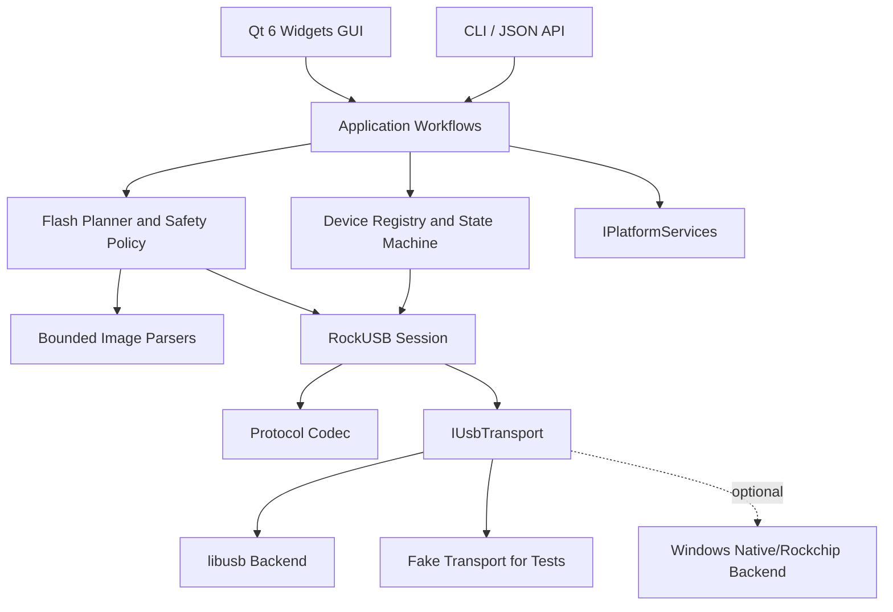

# ZzRkDevTool 跨平台重写项目计划书

| 项目 | 内容 |
|---|---|
| 文档状态 | Draft 0.4 |
| 编制日期 | 2026-07-16 |
| 技术方向 | C++20、Qt 6、libusb、CMake |
| 目标平台 | Windows 10/11、Linux、macOS |
| 首要开发环境 | Ubuntu 26.04 LTS x86_64 |
| 首要硬件范围 | RK3588、eMMC |
| 项目许可证 | MIT |

## 1. 执行摘要

项目可行，但不应把现有 `rkdeveloptool` 套一层 Qt 界面，也不能在 MIT 项目中移植其 GPL 实现。下载的项目只用于确认公开协议事实、观察设备行为和交叉验证测试结果；产品代码从协议规格开始独立实现一个原生 C++20 核心，再由 Qt 6 GUI 和 CLI 共用该核心。

以下决策已经冻结：

1. **许可证**：项目自有代码采用 MIT；不得复制、改写或链接 GPL `rkdeveloptool` 源码。
2. **首要设备**：优先支持 RK3588。
3. **首要存储**：优先支持 eMMC，其他存储不进入首轮承诺。
4. **首要主机**：先在 Ubuntu 26.04 LTS x86_64 完成核心和 GUI，再完成 Windows、macOS 适配。
5. **跨平台边界**：虽然 Linux 优先，但 portable core、USB transport 接口和平台服务接口从第一个 commit 就分离，禁止把 Linux 细节写入业务层。

Windows USB 驱动仍是后续跨平台发布的高风险项，但不再阻塞 Linux MVP。MIT 合规边界则是立即生效的开发门禁。

建议按以下节奏交付：

| 版本 | 目标 | 预计投入 |
|---|---|---:|
| v0.1 Linux 技术预览 | Ubuntu 26.04 上的 RK3588/eMMC 枚举、只读信息、CLI | 3 到 5 人周 |
| v0.5 Linux MVP | RK3588/eMMC 单设备 Loader、读写、备份、校验、Qt GUI | 累计 8 到 12 人周 |
| v1.0 跨平台版 | `update.img`、Windows/macOS 适配、三平台安装包 | 累计 18 到 24 人周 |
| v1.5 | 多设备量产、配置模板、结果报表 | 额外 4 到 6 人周 |

估算假设为一名熟悉 C++/Qt/USB 的全职工程师，已有可破坏测试设备和覆盖目标芯片的固件样本。Windows 驱动签名、Apple 公证账号、硬件采购和协议补充可能拉长日历时间。

## 2. 项目目标

### 2.1 产品目标

- 第一阶段在 Ubuntu 26.04 LTS 上提供可靠的 RK3588/eMMC 烧录体验，随后扩展到 Windows 10/11 和 macOS。
- 支持 Maskrom、Loader 的可靠识别、切换和重枚举关联。
- 支持设备信息、存储信息、分区表、备份、分区烧录、原始烧录、擦除、重启和写后校验。
- 当前排期假设 v1 支持经过验证的 RKFW/RKAF `update.img`，先解析并生成烧录计划，再执行写入；最终范围需由合法样本集合确认。
- 所有高危操作在执行前显示设备、介质、目标范围、镜像类型、容量检查和校验策略。
- GUI、CLI 和将来的量产模式共用同一个核心，不通过解析命令行文本维持业务状态。

### 2.2 工程目标

- C++20，固定宽度整数和强类型单位，禁止混用字节数、扇区数和 LBA。
- USB、协议、镜像解析、烧录编排和 Qt UI 分层。
- 原生异步任务、有限超时、分块取消、断线恢复和结构化进度事件。
- 解析不可信镜像时默认失败关闭，支持 fuzz、ASan 和 UBSan。
- 构建和依赖可复现，发布物固定来源、版本、哈希和许可证清单。
- 平台差异集中在 `platform/linux`、`platform/windows`、`platform/macos` 及 packaging 目录，portable core 不包含平台条件分支。

### 2.3 首版非目标

- 不支持 eFuse、OTP、任意 SDRAM 执行等不可逆专家功能。
- Linux MVP 只承诺 RK3588 和 eMMC，不承诺其他 SoC、SPI NOR/SPI NAND/NAND/UFS 或私有固件变体。
- 不在没有再分发授权的情况下捆绑 DDR、Loader、USB 驱动或厂商固件。
- 不做 App Store / Microsoft Store 沙箱版本。
- v1.0 不把多设备量产作为阻塞项；量产需要独立的设备选择、并发和报告设计。

## 3. 参考项目审计

### 3.1 下载版本

| 目录 | 来源与快照 | 可核对内容 | 主要限制 | 定位 |
|---|---|---|---|---|
| `temp/rkdeveloptool1` | Rockchip 官方仓库，`304f073`，2025-03-07 | RockUSB 命令、Loader、GPT/parameter、Sparse/UBI、RK356x Loader、存储切换 | GPL-2.0+、单进程单设备、同步阻塞、POSIX 偏重、没有完整 `update.img` 升级 | 只核对协议事实和外部行为，禁止复用实现 |
| `temp/rkdeveloptool` | DorianRudolph fork，`e7794bb`，2022-03-27 | 长命令名、按分区读取、分区容量检查、较大传输块 | GPL-2.0+、未合入官方后续存储切换，仍是旧式全局状态和原始指针 | 只作差分行为对照，禁止复用实现 |
| `temp/RKDevelopTool-GUI` | `5.0.6` / `2521ffd`，2026-07-06 | 首页任务入口、设备联动、日志、进度、中英文、打包思路 | 根许可证 GPLv3，子进程文本封装，多项功能与后端契约不一致 | 只研究工作流，不复制代码或 UI 实现 |
| `temp/rkflashtool` | `0a5ad3a`，2020-02-11 | 31/13 字节协议笔记、旧协议 CRC、RKAF/RKFW/RKFP 结构 | 芯片老、边界检查缺失、部分文件授权需逐项确认 | 协议证据和测试结果对照，默认不复制源码 |

两份 C++ CLI 没有谁是完整的“最新版”。官方分支包含 2025 年加入的存储切换，Dorian 分支则包含官方未合入的命令 UX、读取语义和边界检查改进。MIT 实现不能选择任何一个目录作为代码底座；协议规格、生产代码和测试代码都必须由本项目重新编写并保留来源记录。

### 3.2 现有核心的真实模块

- `RKScan`：libusb 枚举、VID/PID、模式识别和轮询等待。
- `RKComm`：接口/端点选择、Bulk/Control 传输、RockUSB CBW/CSW。
- `RKDevice`：设备能力、Loader 下载、Flash 信息、擦除。
- `RKBoot` / `RKImage`：Loader 与 RKFW 外层容器解析。
- `main.cpp`：CLI、GPT、parameter、Sparse、UBI、读写、打包和工作流全部集中在约 3300 行中。
- `crc.cpp`：CRC16、CRC32、RC4、BCH 等算法。

表面上已经分文件，但资源所有权、错误处理、进度、状态和业务编排仍然紧耦合。例如 libusb 全局初始化位于 [`main.cpp`](../temp/rkdeveloptool/main.cpp#L3348)，扫描器保存裸设备引用，通信类使用无限命令超时，工作流依赖全局日志和 CLI 输出。

### 3.3 已确认的关键问题

#### 3.3.1 `update.img` 不是原始整盘镜像

参考 GUI 的“一键完整烧录”执行：

```text
rkdeveloptool wl 0x0 <firmware>
```

见 [`operations.py`](../temp/RKDevelopTool-GUI/rkdeveloptool-gui/operations.py#L412)。`wl` 只是从指定 LBA 原样写入文件。RKFW `update.img` 是带 `BOOT` 和内嵌 RKAF 内容的容器，旧解包器也明确按外层、内层分别处理，见 [`rkunpack.c`](../temp/rkflashtool/rkunpack.c#L136)。因此不能把 `update.img` 直接写到 LBA 0。

两份 `rkdeveloptool` 的 `RKImage` 只解析 RKFW 外层和 Loader，`SaveFWFile`、`GetData`、`GetMd5Data` 没有形成完整升级调用链，见 [`RKImage.cpp`](../temp/rkdeveloptool/RKImage.cpp#L174)。新项目必须新增“容器解析 -> 项目校验 -> 分区映射 -> 烧录计划 -> 执行 -> 回读校验”的完整链路。

#### 3.3.2 CLI 文本契约已经发生漂移

官方版本的 `RL` 长度按扇区解释；Dorian fork 将其改为字节并要求 512 对齐，见 [`main.cpp`](../temp/rkdeveloptool/main.cpp#L3270)。参考 GUI 仍按扇区传参。相同命令名在不同二进制下会产生 512 倍差异，说明产品不能依赖外部 CLI 的文本和隐式单位。

#### 3.3.3 GUI 中存在未实现或错误映射的功能

| GUI 功能 | GUI 调用 | 官方后端实际契约 |
|---|---|---|
| 分区擦除 / 全盘擦除 | `ef <name>` / `ef all` | `ef` 不接受参数，只表示全盘擦除 |
| 打包 / 解包 | `pk` / `uk` | 实际是配置驱动的 `pack` 和 `unpack <loader>` |
| GPT 导入导出 | `gpt import/export` | 实际是 `gpt <parameter-file>` 写入 |
| 读取参数 | 无参数 `prm` | `prm <parameter-file>` 是写参数 |
| 量产 | 多个相同 `wl` 进程 | 没有传设备 ID，后端检测到多设备会拒绝 |
| “进入 Maskrom” | `db loader` | 实际是从 Maskrom 下载临时 Loader，结果进入 Loader |

自动 Loader、烧录前擦除、烧录后校验、烧录后重启、超时和重试也有仅创建控件而没有接入执行链的情况。新 UI 只展示核心确实支持并经过测试的能力。

#### 3.3.4 设备与 USB 状态不够可靠

- 旧实现用 `bus << 8 | firstPort` 作为位置 ID，不能完整表示 Hub 层级，见 [`RKScan.cpp`](../temp/rkdeveloptool/RKScan.cpp#L259)。
- Loader/Maskrom 主要根据 `bcdUSB` 最低位判断，是经验规则而非完整能力探测。
- CLI 发现多设备时拒绝操作，但没有“显式选择设备”的协议入口。
- USB 命令同步执行，命令超时为 0，即可能无限等待，见 [`RKComm.h`](../temp/rkdeveloptool/RKComm.h#L82)。
- 参考 GUI 每两秒启动 `ld`，随后启动 `rci`；烧录时轮询仍可能和写进程竞争 USB。

#### 3.3.5 旧解析器只能作为证据

`rkflashtool` 的协议文档仍有 `foo`、`bar`、`unknown` 字段，说明它是逆向笔记而不是正式规范。其实现还存在忽略 libusb 返回长度、无限超时、响应不校验、非整块写越界、IDB 缓冲区越界等问题。`rkunpack` 对 entry 数量、偏移、长度和输出路径缺少边界约束，恶意镜像可造成越界或路径穿越。

结论：可以使用协议字段、CRC 结果和合法样本构造 golden tests，但不能复制其错误处理和解析方式。

#### 3.3.6 MIT 许可证边界

- 两份核心源码头为 `GPL-2.0+`，例如 [`RKComm.cpp`](../temp/rkdeveloptool/RKComm.cpp#L1)。
- GUI 的 [`pyproject.toml`](../temp/RKDevelopTool-GUI/pyproject.toml#L23) 写 MIT，根 `LICENSE` 是 GPLv3，Linux 包配置又写 GPL-2.0。
- `rkflashtool` 主要源码带 BSD-2-Clause 条款，但协议文档没有独立许可证声明。
- libusb 通常是 LGPL-2.1-or-later；Qt 6 的 LGPLv3/GPL/商业条款取决于模块和分发方式。

项目自有代码确定采用 **MIT**。这意味着：

- 不复制、翻译、改写、链接或编译 `temp/rkdeveloptool*` 与 GPL GUI 的实现、注释和组织结构。
- 仅把可观察的 USB 报文、公开命令行为、文件格式事实和真机输出整理为本项目独立编写的协议规格与 golden vectors。
- `temp/` 不进入产品 target、安装包、源码发布包或 MIT 版权声明范围。
- 若确需复用某个 BSD 文件，必须逐文件确认版权头、保留 BSD notice 并记录在第三方清单；默认策略仍是独立实现。
- Qt 采用商业许可或满足 LGPLv3 的动态链接/可替换要求；libusb 满足 LGPL-2.1-or-later。MIT 只覆盖本项目自有代码，不会覆盖这些依赖。
- 如需要较高等级的商业法律确定性，应由未接触 GPL 实现的开发者依据独立协议规格编码，并进行法律审查。

## 4. 产品范围与版本规划

### 4.1 v0.1：Linux 只读技术预览

- Ubuntu 26.04 LTS x86_64 构建和启动。
- Windows/macOS 此阶段只要求 portable targets 编译和无硬件单测通过。
- Rockchip 设备枚举、热插拔和完整 USB port path 身份。
- Maskrom / Loader 状态显示。
- 读取 Chip Info、Flash ID、Flash Info、Capability、当前存储介质。
- 读取并展示 GPT 或 legacy parameter 分区表。
- CLI 输出 JSON 和普通文本两种格式。
- 结构化日志、错误分类和诊断包。

退出条件：同一套核心在 Ubuntu 26.04 上对至少两台可恢复的 RK3588/eMMC 设备完成只读操作，最好覆盖不同板型或 eMMC 容量；拔线、权限不足和多设备场景不会卡死或误选设备。

### 4.2 v0.5：Linux 单设备 MVP

- Maskrom 下载临时 Loader，并在重枚举后关联同一物理端口。
- 原始 LBA 读写、按分区读写、整盘/分区备份。
- Android Sparse 镜像流式写入；Raw 镜像流式写入。
- GPT 和 legacy parameter 只读；写入能力在独立高危入口开放。
- Loader 升级、测试设备、重启/关机均按 capability 开关；存储切换不进入首轮 eMMC-only UI。
- 写入前容量、范围、镜像类型、芯片族、介质和模式校验。
- 写后回读校验，可选全量或抽样；关键元数据默认全量。
- Qt Widgets GUI，中英文、系统明暗主题、任务日志、进度和安全取消。

退出条件：在 RK3588/eMMC 专用测试分区上反复执行写入、回读、哈希一致；传输中拔线、超时和取消后能得到明确失败状态，不继续执行后续步骤。

### 4.3 v1.0：完整固件与跨平台正式发布

当前工期按 `update.img` 纳入 v1 估算；若样本授权或格式覆盖无法满足门禁，v1 应明确降级范围，而不是保留一个未经验证的一键入口。

- 有界解析 RKFW、RKAF，并按样本需要补充 RKFP。
- 校验 header、entry、offset/size、重叠、CRC/MD5 和芯片族信息。
- 从 `update.img` 生成不可变 `FlashPlan`，显示每个目标分区、LBA、长度和校验方式。
- 支持经过样本和真机矩阵验证的完整固件升级，不支持的变体明确拒绝。
- GPT/parameter 的备份、导出、受控写入和写后复读。
- Windows 签名安装器及 USB 驱动方案、Linux 包和 udev、macOS 签名/公证 DMG。
- 用户手册、恢复手册、第三方许可证、SBOM 和发布哈希。

### 4.4 v1.5：量产模式

- 每台设备使用稳定 port path 选择，命令不再是“对第一台设备执行”。
- 每设备独立状态机、操作锁、进度、结果和重试策略。
- 固件/Loader/介质/校验策略模板。
- 并发上限和 USB 控制器带宽调度。
- 条码/序列号输入接口、CSV/JSON 报表和失败设备隔离。

量产不能通过并发启动多个未指定设备的 CLI 进程实现。

## 5. 推荐架构



### 5.1 构建目标

| Target | 职责 | 依赖约束 |
|---|---|---|
| `zzrk_core` | 强类型、错误、设备模型、操作事件 | 纯 C++20，不依赖 Qt Widgets |
| `zzrk_protocol` | CBW/CSW、opcode、CRC、字节序序列化 | 只处理 `std::byte`，可单测 |
| `zzrk_usb` | RAII libusb、枚举、hotplug、传输、取消 | 不包含 UI 文本 |
| `zzrk_image` | Raw/Sparse/RKBoot/RKFW/RKAF/GPT/parameter | 有界流式解析，可 fuzz |
| `zzrk_workflow` | 设备状态机、FlashPlan、任务调度、安全策略 | 依赖抽象 transport 和 image |
| `zzrk_platform` | 权限/驱动诊断、平台路径、休眠与系统集成 | 每个平台独立 target/source set |
| `zzrk_cli` | 诊断、自动化、JSON 输出 | 与 GUI 共用 workflow |
| `ZzRkDevTool` | Qt Widgets UI、QSettings、翻译、平台集成 | 不直接调用 libusb |

旧 CLI 可以保留为研究环境里的差分测试 oracle，但不作为产品后端，也不进入正常运行路径。

### 5.2 核心设计原则

#### 强类型单位

定义 `ByteCount`、`SectorCount`、`Lba`、`PartitionSize`，只允许显式转换。所有内部容量使用 `std::uint64_t`，协议字段变窄前检查上限。禁止以裸 `uint32_t` 同时表示地址、字节和扇区。

#### 显式协议编码

使用 `std::span<std::byte>` 和固定偏移读写大小端字段，不把 packed C struct 直接映射为线格式。每次响应校验：

- `USBS` signature；
- 请求 tag 回显；
- 实际传输长度；
- status/error flag 和设备错误码；
- 数据阶段与命令阶段顺序。

#### RAII 和可注入 transport

libusb context、device、handle、claimed interface 和 kernel driver detach 都由 RAII 对象管理。`IUsbTransport` 支持 fake 实现，以便注入短传输、stall、timeout、断线和重枚举。

#### 每设备状态机

```text
Disconnected
  -> DetectedMaskrom
  -> LoadingTemporaryLoader
  -> Reenumerating
  -> ReadyLoader
  -> Planning
  -> Writing
  -> Verifying
  -> ReadyLoader / Failed / Disconnected
```

每台设备同一时间只允许一个破坏性任务。烧录期间设备监控读取缓存状态，不并发打开同一接口。Loader 下载后的设备用完整 USB port path、VID/PID 变化和时间窗进行关联。

#### 先计划，后写入

任何写操作先生成不可变 `FlashPlan`。计划包含：

- 设备 ID、芯片、模式和目标存储；
- 镜像格式、来源、长度和摘要；
- 每个 step 的分区/LBA、字节范围、擦除要求和 capability；
- 预计写入量、校验方式和重启行为；
- 所有警告、阻塞错误和用户确认记录。

UI 不能绕过 planner 直接发 `writeLba()`。

#### 安全取消

取消使用 `std::stop_token` 或等价机制，只在 USB 分块边界停止。不得像参考 GUI 一样直接 kill 子进程后宣称已取消。取消后停止后续计划、关闭接口、等待设备重连并输出“已写入到哪个范围”的结果。

### 5.3 平台隔离规则

- `core`、`protocol`、`image` 和 `workflow` 不包含 `#ifdef __linux__`、Windows API、IOKit、udev 或平台路径拼接。
- 通用 libusb 逻辑位于 `transport/libusb`；权限、驱动诊断、休眠通知和安装状态位于各平台目录。
- `platform/linux` 负责 udev 权限诊断和 Linux 系统集成。
- `platform/windows` 负责驱动绑定/版本诊断和 Windows 设备安装提示。
- `platform/macos` 负责 macOS USB/休眠诊断、bundle 路径与签名相关运行检查。
- CMake 通过平台专属 target 或 `target_sources()` 选择实现，不让业务代码散布条件编译。
- fake transport 和 fake platform services 必须能在任意 CI 主机运行，避免跨平台测试依赖真实 USB。

## 6. 镜像与烧录策略

### 6.1 支持格式

| 格式 | v0.5 | v1.0 | 处理原则 |
|---|---:|---:|---|
| Raw image | 是 | 是 | 文件大小必须落入目标范围 |
| Android Sparse | 是 | 是 | 流式展开，检查 chunk 和输出总长 |
| RKBoot / Loader `.bin` | 是 | 是 | 校验 BOOT/LDR tag、entry、CRC、芯片族 |
| GPT | 读 | 读写 | 校验主/备份 header、entry CRC、容量 |
| legacy parameter | 读 | 读写 | 有界 parser，CRC 和副本布局按设备能力 |
| RKFW / RKAF `update.img` | 否 | 是 | 完整解析后映射分区，绝不原样写 LBA 0 |
| RKFP | 否 | 按样本决定 | 没有完整样本和硬件前不承诺 |
| UBI/UBIFS | 否 | 后续版本 | 不属于 RK3588/eMMC 首轮范围 |

### 6.2 解析器要求

- 文件不足最小 header 长度立即失败。
- 所有 `offset + size` 使用 checked arithmetic 并限制在文件范围内。
- 限制 entry count、字符串长度和总展开大小。
- 拒绝重叠 entry、重复目标和路径穿越。
- 不依赖扩展名识别格式，扩展名仅作提示。
- 对大于 4 GiB 的文件流式处理，不整包载入内存。
- CRC/MD5 只表示格式或传输完整性，不能显示为“可信签名”。
- 真正的签名验证必须使用经过审查的密码库和明确的厂商公钥/格式，不手写密码算法。

### 6.3 写前检查

- 当前设备必须仍是计划中的同一 USB port path。
- 模式、芯片族、存储介质、容量和 capability 未变化。
- 文件 mtime/size/hash 与生成计划时一致。
- 写入范围不能溢出设备、分区或协议字段。
- Raw LBA 0 写入放入“高级原始操作”，不使用“一键完整固件”文案。
- GPT、Loader、parameter、首 4 MiB、全盘擦除使用更高等级确认。

### 6.4 写后校验

提供三档策略：

- `Full`：完整回读并比较摘要；Loader、GPT、parameter 默认使用。
- `Sampled`：首尾加固定/随机块抽样；适合大分区快速验证。
- `None`：仅专家模式允许，并在最终结果中明确标记“未校验”。

协议返回成功不等于介质写入正确，不能用它替代 readback。

## 7. Qt 6 桌面应用计划

### 7.1 技术选择

- Qt Widgets，适合高密度、重复操作的桌面工具，不使用营销式首页。
- Qt Core、Gui、Widgets、LinguistTools；谨慎增加额外 Qt 模块。
- `QSettings` 保存窗口布局、语言、主题、最近目录和非敏感偏好。
- `.ts/.qm` 管理中英文，不使用 600 多行手写翻译字典。
- `QAbstractTableModel` 展示设备、分区、计划步骤和日志，避免反复重绘整个文本缓冲。
- Qt 层只订阅 typed event，不解析 stdout 百分比和英文错误文本。

### 7.2 首版信息架构

1. **设备**：设备列表、Mode、SoC、USB path、存储、容量、权限/驱动状态。
2. **烧录**：选择镜像后显示识别结果和 FlashPlan；只有校验通过才允许开始。
3. **分区**：分区表、备份、写入、校验；高危写入使用独立对话框。
4. **工具**：Loader、设备测试、重启、离线解包；非 eMMC 存储切换后置。
5. **任务与日志**：阶段、总进度、当前 step、速度、已处理量、可行动错误、导出诊断包。

首页可以保留参考 GUI 的常用任务入口，但入口必须导航到真实配置页，不能绕过预检直接执行命令。高级原始 LBA、全盘擦除和 Loader 升级默认折叠并明确标识风险。

### 7.3 错误体验

错误模型至少区分：

- `PermissionDenied`：Linux udev / macOS 权限；
- `DriverUnavailable`：Windows 驱动未绑定或不兼容；
- `DeviceDisconnected` / `DeviceChanged`；
- `UsbTimeout` / `UsbStall` / `ShortTransfer`；
- `ProtocolStatusError`；
- `UnsupportedMode` / `UnsupportedCapability`；
- `InvalidImage` / `WrongChip` / `TargetTooSmall`；
- `VerificationFailed`。

UI 显示解决动作，例如“安装驱动”“重新连接同一 USB 口”“选择 Loader”，不只显示负数返回码。

## 8. 三平台实现与交付

### 8.1 Linux，首要实现

- 主开发与首轮真机系统固定为当前 Ubuntu 26.04 LTS x86_64。
- 首个硬件组合固定为 RK3588 + eMMC；Maskrom 和 Loader 都必须验证。
- 当前工程使用 `/home/zz/Qt/6.11.1/gcc_64` 的 Qt 6.11.1，以及 `thirdParty/libusb` 的 libusb 1.0.30；CMakeUserPresets 记录本机 Qt 路径。
- 开发依赖至少包括 `build-essential`、`cmake`、`ninja-build`、`pkg-config`、`qt6-base-dev`、`qt6-tools-dev`、`libusb-1.0-0-dev`、`clang` 和 `clang-tidy`。
- udev 使用 `TAG+="uaccess"` 或受控组，不使用 `MODE="0666"`。
- 处理 kernel driver detach/reattach、权限变更、休眠和热插拔。
- Linux MVP 先提供开发包或 deb；AppImage/rpm 在核心稳定后补齐。AppImage 无法可靠安装 udev，需提供独立规则包和明确诊断。
- 在 Wayland/X11 下验证文件对话框、主题和高 DPI。
- 若未来要求兼容 Ubuntu 24.04 或其他旧发行版，发布二进制必须在选定的最低 glibc 基线上构建，不能用 Ubuntu 26.04 构建物反向假定兼容。

### 8.2 Windows 10/11，第二阶段

开发与 CI 以 MSVC x64 为主，MinGW 仅作为可选兼容矩阵。进入 Windows 适配阶段后完成驱动 spike：

1. 列出 RK3588 在 Maskrom、Loader 下的 VID/PID、interface 和 endpoint。
2. 验证官方 Rockchip 驱动下 libusb 各 backend 的打开与读信息能力。
3. 验证 WinUSB/libusbK 绑定后是否影响官方 RKDevTool 共存。
4. 选择正常用户不需要 Zadig 的安装方案。
5. 准备签名 INF/CAT、安装、升级、回滚和卸载测试。

交付建议为签名 MSI/EXE 安装器和不带驱动的便携诊断包。驱动安装需要管理员权限，正常烧录运行不应要求管理员权限。

### 8.3 macOS

- arm64 为首要目标；是否提供 universal2 由 Intel Mac 支持决策决定。
- bundle Qt 与 libusb，检查 rpath 后对整个 `.app` 递归签名。
- 非 App Store 分发，完成 hardened runtime、notarization、staple 和 DMG。
- 真机验证 USB 独占、系统休眠、Hub、拔插和应用升级。
- 未签名“右键打开”只适合内部预览，不能作为 v1 正式交付。

### 8.4 版本基线

- C++20。
- CMake 3.25+，Ninja，CMake Presets。
- Qt 6.11.1 作为 Ubuntu 26.04 首轮开发基线；跨平台发布时固定并验证各平台同一 Qt minor/patch 策略。
- libusb 1.0.30 作为 Ubuntu 26.04 首轮开发基线；跨平台发布固定源码/二进制哈希。
- 依赖优先通过 vcpkg manifest 或受控构建脚本提供，发行版构建可选择系统库。

## 9. 仓库与构建结构

```text
ZzRkDevTool/
  LICENSE
  NOTICE.md
  .gitignore
  CMakeLists.txt
  CMakePresets.json
  cmake/
  apps/
    gui/
    cli/
  src/
    core/
    protocol/
    transport/
    image/
    workflow/
    platform/
      linux/
      windows/
      macos/
  tests/
    unit/
    integration/
    fuzz/
    hardware/
    fixtures/
  docs/
    protocol/
    hardware-matrix/
    decisions/
  packaging/
    windows/
    linux/
    macos/
  third_party/
  tools/
```

`temp/` 保持本机研究资料属性，由根 `.gitignore` 排除，不进入产品 target、MIT 源码提交或安装包。MIT `LICENSE` 不覆盖其中的第三方项目；`NOTICE.md` 明确记录这一边界。

构建要求：

- `CMAKE_CXX_STANDARD 20`，禁用编译器扩展。
- GCC/Clang：`-Wall -Wextra -Wpedantic -Wconversion`；MSVC：`/W4 /permissive-`。
- CI 中 warnings-as-errors，发布构建可以对外部头单独降噪。
- Linux/macOS Debug 启用 ASan/UBSan；可用时加入 MSVC ASan。
- clang-format、clang-tidy、依赖许可证扫描和 SBOM。
- 不在 release 脚本中 `git clone --depth 1` 未固定的后端源码。
- 所有项目自有源码使用 `SPDX-License-Identifier: MIT`；第三方文件不得套用项目 SPDX 头。

## 10. 实施里程碑

### M0：立项门禁与可行性，1 到 2 人周

交付：

- 已接受的 MIT/参考资料边界 ADR 和第三方来源登记规则。
- Ubuntu 26.04 开发环境清单与可重复安装步骤。
- 至少两台可恢复 RK3588/eMMC 测试设备及恢复方案。
- Linux 最小 libusb probe，在 Maskrom/Loader 下枚举 RK3588。
- `IUsbTransport`、`IPlatformServices` 和三平台 source set 接口草案。
- 协议字段说明和首批 golden USB trace。
- 合法固件/Loader 样本清单和 SHA-256。

门禁：Ubuntu 26.04 上的 RK3588/eMMC 至少能够在 Loader 模式执行一个只读命令，并能够识别 Maskrom；否则先调整 transport 和协议规格，不进入 GUI 开发。

### M1：工程骨架，1 人周

交付：

- CMake targets、Presets、依赖锁定。
- Linux 完整 CI，Windows/macOS portable targets 编译与无硬件单测 CI。
- typed error、units、event、logging 基础。
- Catch2 单测、sanitizer 和 fixture 机制。

### M2：协议与只读核心，2 到 3 人周

交付：

- CBW/CSW codec 和 CRC golden tests。
- RAII libusb backend、descriptor 驱动端点选择。
- device registry、hotplug/poll fallback、完整 port path。
- Chip/Flash/Capability/Storage/GPT/parameter 读取。
- `zzrk_cli list/info/partitions` 和 JSON 输出。

验收：fake transport 覆盖短传输、错误 status、stall、timeout、拔线和两台设备；Ubuntu 26.04 + RK3588/eMMC 硬件只读回归通过。

### M3：单设备写入核心，3 到 4 人周

交付：

- 临时 Loader 下载与重枚举状态机。
- Raw/Sparse 流式写入，分区和 LBA 读写。
- FlashPlan、安全策略、进度、速度、分块取消。
- Loader/GPT/parameter 高危操作。
- 全量/抽样 readback 校验。

验收：只在可恢复 RK3588/eMMC 测试设备和 scratch partition 上执行；对每个写入 stage 做拔线与超时注入，不发生跨目标继续写入。

### M4：Qt GUI MVP，2 到 3 人周

交付：

- 设备、烧录、分区、工具、任务日志五个视图。
- 中英文 `.qm`、系统主题、QSettings。
- 计划预览、确认、取消、断线提示和诊断导出。
- UI 单元测试和无设备演示模式。

### M5：`update.img`，3 到 5 人周，待样本范围冻结

交付：

- RKFW/RKAF bounded parser 与 fuzz target。
- container checksum/metadata 校验。
- entry 到分区/LBA 的受控映射。
- 完整固件 FlashPlan 和按阶段校验。
- 已支持/拒绝的格式版本文档。

验收：所有样本先和可信工具离线对比 entry、offset、size 和 hash，再做真机升级；未知变体必须在写入前失败。

### M6：Linux 加固、跨平台适配与 v1 发布，4 到 6 人周

交付：

- 先完成 Ubuntu 26.04 udev、deb 和 Linux 正式回归，再补 rpm/AppImage。
- 复用同一 portable core 完成 Windows transport/driver 诊断、驱动和签名安装器。
- 复用同一 portable core 完成 macOS transport/系统集成、codesign、notarization 和 DMG。
- 硬件矩阵、故障注入、24 小时稳定性和升级测试。
- 用户/恢复/许可证文档、SBOM 和发布 checksums。

### M7：量产，4 到 6 人周，可选

在单设备 v1 稳定后单独实施，不与 v1 核心正确性并行冒险。

## 11. 测试计划

### 11.1 单元与 golden tests

- 31-byte request、13-byte response 的逐字节向量。
- opcode、subcode、大小端、最大地址/长度和 overflow。
- CRC16/CRC32 与历史工具、已知样本交叉验证。
- GPT 主/备份 header 和 entry CRC。
- Raw/Sparse/RKBoot/RKFW/RKAF/parameter 的正常、截断和损坏样本。
- FlashPlan 在芯片不符、目标过小、范围重叠和介质变化时拒绝执行。

### 11.2 Fake transport 集成测试

- short read/write、zero progress、stall、timeout、busy、取消。
- status signature/tag/error 不匹配。
- 每个写块后断线。
- Maskrom 下载后正确/错误设备重枚举。
- 两台相同 VID/PID 设备并存，不能串设备。
- UI 关闭、系统休眠和应用恢复。

### 11.3 Fuzz 与安全测试

- RKAF/RKFW/RKFP/RKBoot/Sparse/GPT/parameter parser。
- 超大 count、offset 加法溢出、重叠 entry、重复名称。
- 路径 `../`、绝对路径、非法 Unicode、符号链接。
- 大于 4 GiB、稀疏超大逻辑尺寸和磁盘空间不足。
- Linux 定期 libFuzzer + ASan/UBSan，保存所有回归 corpus。

### 11.4 硬件矩阵

Linux MVP 的必测矩阵收敛为 RK3588/eMMC：

| 代表平台 | 模式 | 存储 | 数量建议 | 用途 |
|---|---|---|---:|---|
| RK3588 板卡 A | Maskrom/Loader | eMMC user area | 1 | 主要开发和破坏性测试 |
| RK3588 板卡 B | Maskrom/Loader | eMMC user area | 1 | 不同板型或容量的回归 |

先备份全盘和 Loader，确认 Maskrom 恢复方式，再进行破坏性测试。eMMC `boot0`、`boot1` 和 RPMB 是否支持仍需单独决策，未明确前只承诺 user area。

RK3566/3568、RK3576、RK3399、旧 RK32xx、SPI NOR、SPI NAND、NAND 和 UFS 属于未来兼容矩阵，不阻塞 RK3588/eMMC Linux MVP，也不得在界面中提前宣称支持。

### 11.5 OS 发布矩阵

- P0/MVP：Ubuntu 26.04 LTS x86_64，RK3588/eMMC 真机。
- 从 M1 开始：Windows x64、macOS arm64 对 portable targets 做 compile-only 和无硬件测试。
- v1 跨平台发布：Windows 10 22H2 x64、Windows 11 x64、选定 macOS arm64 版本完成 RK3588/eMMC 真机验证。
- Ubuntu 24.04、Linux arm64 和 Intel macOS 是否发布，在最低 ABI 与真机 runner 明确后另行决定。

## 12. CI/CD

每个 PR：

- MSVC、GCC、Clang 编译。
- unit/integration tests、格式、静态分析。
- Linux ASan/UBSan。
- 不连接真实设备，不执行任何破坏性命令。

定时任务：

- parser fuzz corpus。
- 依赖漏洞、许可证和 SBOM 扫描。
- 自托管硬件 runner 上的只读回归。

发布 tag：

- Linux preview/MVP tag 先从锁定依赖构建 Ubuntu 产物；v1 跨平台 tag 再构建三平台产物。
- 签名/公证。
- 安装、启动、卸载 smoke test。
- 生成 SHA-256、SBOM、第三方声明和 release notes。
- 破坏性硬件测试由人工批准的独立 workflow 触发。

## 13. 风险登记

| 风险 | 概率 | 影响 | 缓解与门禁 |
|---|---|---|---|
| Windows 驱动无法直接被 libusb 使用 | 高 | 高 | M6 Windows 适配先做真机 spike；保留 transport 抽象和 Windows 专用后端可能性 |
| 现代 SoC 协议/capability 不完整 | 中高 | 高 | 每个承诺 SoC 真机、只读 trace、未知能力失败关闭 |
| `update.img` 存在未覆盖变体 | 高 | 高 | 建样本库、bounded parser、显式支持矩阵、未知版本拒绝 |
| MIT 代码无意派生或混入 GPL 实现 | 中 | 高 | `temp/` 隔离、独立规格、来源记录、review 禁止复制、必要时法律复核 |
| Qt/libusb 的 LGPL 分发义务遗漏 | 中 | 高 | 动态链接优先、可替换性、许可证文本、源码获取说明和 SBOM |
| 误写导致数据丢失或设备不可启动 | 中 | 高 | FlashPlan、范围/芯片/介质校验、双确认、readback、scratch 测试 |
| 拔线/休眠/取消造成状态失控 | 中 | 高 | 每设备状态机、有界 timeout、分块取消、故障注入 |
| 多设备串写 | 中 | 高 | v1 只显式单设备；v1.5 使用完整 port path 和每设备锁 |
| Loader/驱动没有再分发权 | 中 | 中高 | 默认不捆绑，用户提供；获得明确授权后再进入安装包 |
| Linux-first 演变成 Linux-only | 中 | 中高 | M1 起 Windows/macOS 编译与无硬件单测，平台目录和接口 review 门禁 |
| 三平台发布流程最后才暴露问题 | 中 | 中高 | Linux MVP 后立即进入 M6 平台适配，不等功能继续扩张 |

## 14. 验收标准

### 14.1 v0.5 Linux MVP

- Ubuntu 26.04 LTS x86_64 可安装、启动并通过 udev 以普通用户访问设备。
- 两台 RK3588/eMMC 设备在 Maskrom/Loader 下可稳定识别并以完整 USB port path 区分。
- eMMC user area 的只读、scratch partition 写入、回读和校验通过。
- 非 RK3588、非 eMMC、越界目标和未知镜像在写入前被拒绝。
- Windows/macOS portable targets 保持编译和无硬件单测通过。

### 14.2 v1.0 跨平台版

- 安装完成后，三平台普通用户可以枚举并打开已配置驱动/权限的设备。
- 多设备连接时必须显式选择，不默认操作第一台。
- 能稳定识别 Maskrom/Loader，并完成 Loader 下载和同端口重枚举。
- 设备、Flash、capability、存储和分区信息与可信工具结果一致。
- Raw、Sparse、分区镜像和已支持的 `update.img` 在硬件矩阵上写入与回读一致。
- 错芯片、错介质、超分区、损坏容器、未知 `update.img` 版本在任何写入前被拒绝。
- 拔线、USB stall、timeout、取消和关闭应用不会继续执行后续写入，也不会卡死 UI。
- 最终报告包含设备、固件 hash、计划、每步耗时、写入范围、校验方式和结果。
- 所有 parser fuzz 回归样本不崩溃、不越界；核心单元/集成测试通过。
- Windows 包已签名并验证驱动安装/卸载；macOS 完成签名与公证；Linux 权限方案不使用全局 `0666`。
- 发布物包含 MIT 源码、所有第三方许可证义务、第三方声明、SBOM 和 SHA-256。

## 15. 决策状态

已冻结：

1. 项目自有代码采用 MIT，GPL 参考实现不进入产品代码或分发物。
2. 首要 SoC 为 RK3588。
3. 首要存储为 eMMC，首轮默认只承诺 user area。
4. 首要主机为 Ubuntu 26.04 LTS x86_64，Windows/macOS 后续适配。
5. 从第一天建立 portable core、transport 和三平台 platform source set，不以 Linux 专用实现污染核心。

仍需冻结：

1. eMMC 是否支持 `boot0`、`boot1`，以及是否明确永久排除 RPMB 写入。
2. 是否确认当前工作假设：`update.img` 是 v1 核心需求，以及可以合法用于测试的固件样本集合。
3. macOS 是否只支持 Apple Silicon，还是必须提供 universal2。
4. 量产模式的优先级、最大并发、是否需要条码/序列号烧录。
5. Windows 是否允许安装自有签名驱动，是否必须与官方 RKDevTool 驱动共存。
6. Linux 正式包的最低兼容基线是否需要覆盖 Ubuntu 24.04。

## 16. 推荐的第一迭代

第一迭代只做 Linux-first M0，不画完整 GUI：

1. 落地 MIT `LICENSE`、参考资料边界和架构决策记录。
2. 选定至少两块 RK3588/eMMC 测试板及其恢复路径。
3. 安装并锁定 Ubuntu 26.04 的 Qt、libusb、pkg-config、Clang 和构建依赖。
4. 在 Linux 上实现最小 libusb probe，同时建立 Windows/macOS compile-only source set。
5. 编码并测试 `ReadChipInfo`、`ReadFlashInfo`、`ReadCapability`。
6. 记录同一设备从 Maskrom 下载 Loader 到重枚举的完整 USB 身份变化。
7. 用 fake transport 建立第一批成功、timeout、short transfer、拔线测试。
8. Ubuntu 26.04 + RK3588/eMMC 只读链路通过后，再搭建正式 Qt 界面；Windows 驱动不阻塞 Linux GUI。

这一步会最早暴露真正影响项目成败的问题，同时产出的 transport、codec、测试向量和状态机都直接进入正式代码，不是一次性原型。

## 17. 当前开发基线

截至 2026-07-17，首个 Linux-first 开发基线已经落地：

- Qt 6.11.1、C++20、CMake Presets 和仓库内 libusb 1.0.30 已完成 Debug、Release、ASan/UBSan 构建验证。
- `libusb-1.0.pc` 使用相对 `pcfiledir`，仓库移动后仍能解析正确的 include 和 library 路径。
- portable preset 不加载 Qt 或 libusb，并实际编译 core、protocol、当前平台 source set 和无硬件测试，为 Windows/macOS compile-only CI 保留边界。
- 已实现字节数、扇区数、LBA 强类型，以及 31-byte CBW、13-byte CSW 的显式编解码和 golden tests。
- 已实现 RAII libusb context、RockUSB VID/PID 过滤、Maskrom/Loader 识别、完整 USB port path，以及按 bus、完整端口链和描述符重新选择设备的单设备 libusb backend。
- CLI 已支持只读 `list`、显式 `probe <port-path>` 和 `read-chip-info <port-path>`；设备命令仅接受观测到的 RK3588 Loader 身份、`bcdDevice 0x0223` 与精确接口布局，并在成功输出前验证 claim/release。Qt Widgets 设备列表仍只做后台扫描，不阻塞 UI。
- fake-libusb、CLI 输出与选择、session 故障矩阵、typed ReadChipInfo、spdlog 生命周期和 Qt 离屏 smoke tests 已建立。当前 Linux Debug、Release、Sanitizer 各有 9 项通过，portable 有 4 项通过。
- target-private `RockusbSession` executor 内部生成 tag，严格执行 CBW、DATA IN、CSW，短传输或失步错误后进入 Faulted；首个公开操作只返回固定 16-byte `ChipInfo` 值，公共头、CLI 和 GUI 均不暴露写入或 raw CDB 入口。
- 应用日志通过 `zzrk_logging` 封装 spdlog v2；协议与 session 保持无日志副作用，CLI 的结构化结果继续使用 stdout。

当前仍保持严格安全边界：`probe` 只执行 open、claim、release、close；`read-chip-info` 只增加一笔固定 31-byte CBW 和两笔固定长度 DATA IN/CSW。两者都要求显式物理端口和完全匹配的 Loader，不会设置 configuration、切换 alternate setting、detach 驱动、reset 设备、clear halt 或访问 eMMC。开发树暂不生成安装目标，正式部署必须同时处理 Qt libraries、platform plugins 和各平台 libusb。

Ubuntu 26.04 真机已验证 `pudu_rk3588s` 在同一物理端口下的 ADB、Loader、Maskrom 身份变化；claim-only probe 和 typed ReadChipInfo 均成功。ReadChipInfo 的项目轨迹严格为 OUT 31、IN 16、IN 13，CSW residue/status 为零，显式 release 成功且无其他 USB 状态操作。16-byte 响应语义仍保持 opaque，因此该结果不能描述为已经识别所有 RK3588 变体，更不能描述为已支持烧录。

下一批开发按以下顺序推进：

1. 分别为 ReadFlashInfo 和 ReadCapability 建立项目自有 trace，固定 opcode/CDB、响应长度、CSW residue/status 和 timeout；在此之前不猜测协议常量。
2. 在现有 `IUsbTransport` 和 faulting session 上实现对应 typed 操作，仍不加入任何写入命令。
3. 用额外板卡和 Loader revision 建立 ChipInfo 16-byte 值的语义与兼容矩阵，并确认介质为 eMMC user area，再扩展 CLI `info`/JSON 和 Qt 只读详情页。
4. 完成第二块 RK3588/eMMC 测试板的 Maskrom/Loader 只读回归后，才进入 Loader 下载和写入规划阶段。
